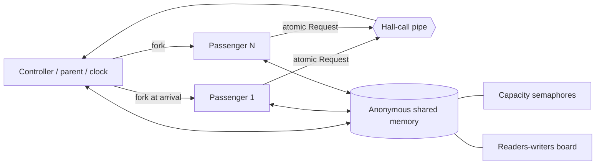

# lift-os-sim

> A building with several lifts compares FCFS and nearest-stop-first on the same passengers, showing how scheduling policy changes waiting time and utilization.

This Operating Systems Laboratory mini project uses Linux processes, `fork`, `waitpid`, pipes, process-shared semaphores, readers-writers synchronization, FCFS and an SRTF analogue. The core scheduler is pure C; the live controller wraps it with real passenger processes. A terminal view and self-contained browser race visualize the same exported run.


## Build and run

Use Linux or WSL2:

```bash
cd "/mnt/d/Desktop/Study/Btech/Semester 5/OSL/Mini Project/lift-os-sim"
make
make test
make smoke
./run.sh
```

The fastest way to prepare the browser comparison is:

```bash
./run.sh compare
```

Then double-click `viz/index.html`. It works over `file://`; no server, packages, internet connection or external JavaScript library is required.

## Direct commands

```bash
./lift_sim --scenario scenarios/rush_morning.csv --policy fcfs
./lift_sim --scenario scenarios/rush_morning.csv --policy nearest
./lift_sim --scenario scenarios/rush_morning.csv --policy nearest --no-ui --fast
```

| Flag | Purpose |
|---|---|
| `--scenario FILE` | Load a validated scenario |
| `--policy fcfs\|nearest` | Select the lift scheduling policy |
| `--tick-ms N` | Set real milliseconds per simulation tick |
| `--fast` | Use 40 ms ticks |
| `--no-ui` | Print events and the final table without ANSI drawing |
| `--no-sync` | Disable display-board synchronization to reveal corruption |
| `--lazy-reap N` | Keep delivered passengers as zombies for N ticks |
| `--out DIR` | Export JavaScript and CSV files to another directory |
| `--seed N` | Record a reproducibility seed in export metadata |
| `--help` | Show usage |

Exit status is 0 for success, 1 for bad input and 2 for an internal or system-call error. `Ctrl+C` terminates and reaps passengers and restores the terminal cursor.

## Process architecture



There are no helper processes. The controller owns all scheduling and output. Passenger processes send one fixed-size hall call, poll the shared floor board, and execute capacity semaphore operations when commanded.

## Scenario format

```text
@floors=10
@lifts=3
@capacity=6
@start=0,4,9
# id,arrival,from,to
1,0,0,7
2,0,0,5
```

Floors are numbered `0..F-1`. IDs must be unique; origins and destinations must differ. The loader reports malformed configuration, invalid floors, wrong start counts and more than 64 passengers.

Generate a repeatable morning scenario with Bash and AWK:

```bash
tools/gen_scenario.sh 42 40 10 > scenarios/generated.csv
```

## Algorithms

- **FCFS:** assigns to the lift with the fewest stops and processes each lift's ordered stop queue without skipping.
- **Nearest-stop-first:** assigns by pickup distance and selects the closest eligible stop every tick. It may preempt a previous target, like SRTF.
- **Capacity:** each lift has a counting semaphore. The passenger process uses `sem_trywait` when boarding and `sem_post` when leaving.
- **Display board:** waiting/riding passengers are concurrent readers; the controller is the single writer. `--no-sync` makes sequence corruption visible.
- **Determinism:** the controller reads exactly one `Request` per new passenger and sorts the batch by ID before advancing the pure engine.

Nearest-stop-first can starve a far-floor call when closer calls keep arriving. The first readers-writers solution can theoretically starve the writer. These limitations are demonstrated and discussed in [the report](docs/report.md).

## Verification

```bash
make test      # pure golden scenarios A, B, C; rush invariants; determinism
make smoke     # live processes agree with scenario A golden results
make asan      # AddressSanitizer and UndefinedBehaviorSanitizer build
make clean
```

The committed `rush_morning.csv` is exactly the output of `tools/gen_scenario.sh 42 40 10`. On it, nearest-stop-first lowers average waiting time and raises average load while finishing sooner.
