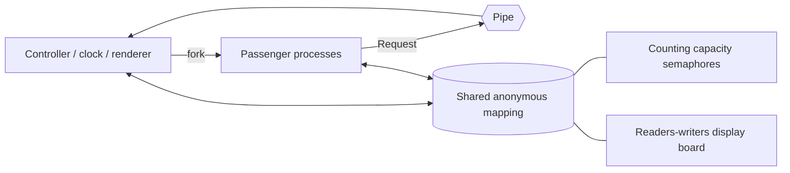
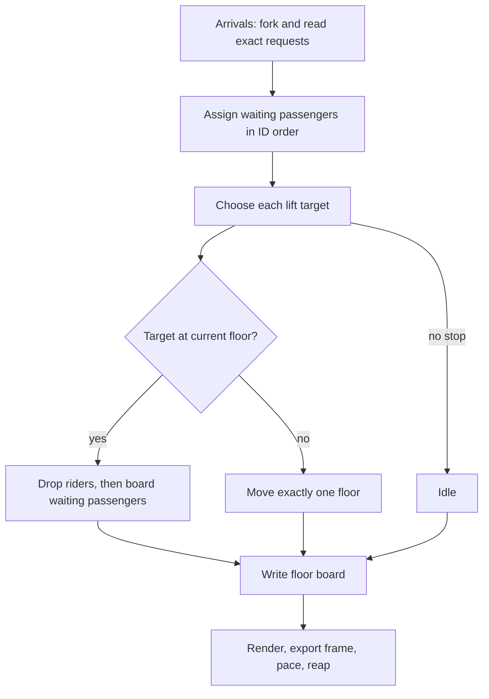
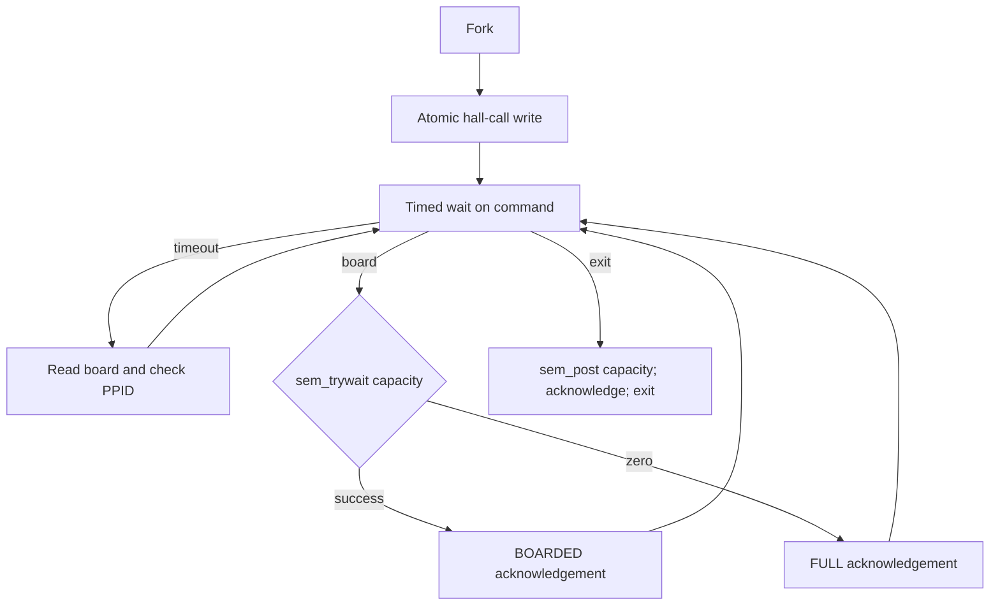
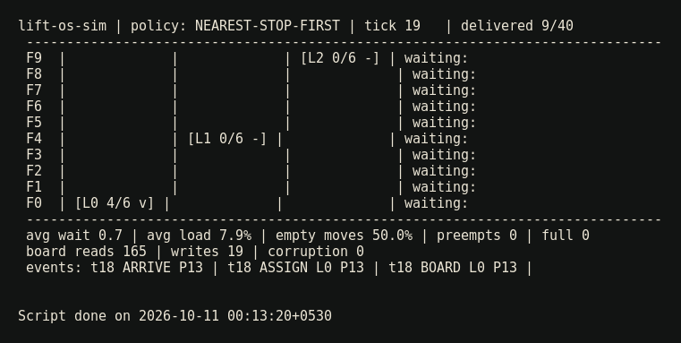
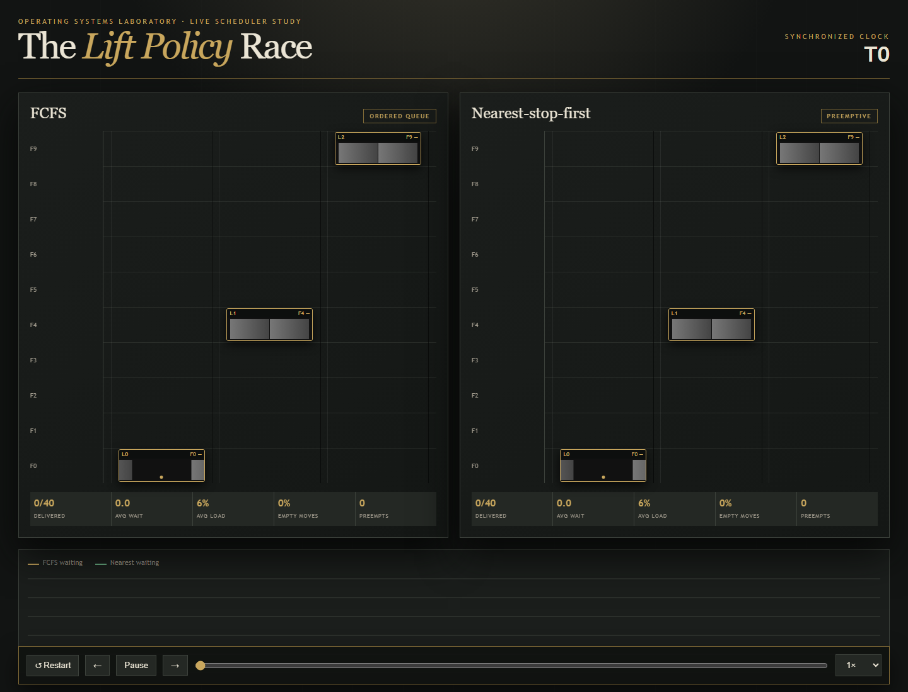

# Title

Smart Lift Controller — FCFS versus Nearest-Stop-First

# Aim

To implement a deterministic multi-process lift controller in C11 and use a familiar building simulation to demonstrate process creation, CPU scheduling analogues, pipe IPC, counting semaphores, readers-writers synchronization, zombies and orphans.

# Objectives

- Fork one real process per passenger and reap it correctly.
- Compare non-preemptive FCFS with preemptive nearest-stop-first.
- Send hall calls through one atomic pipe write.
- Enforce lift capacity through process-shared counting semaphores.
- Protect a shared floor display using the first readers-writers solution.
- Keep scheduling pure so hand-verified cases and live execution use identical logic.
- Present the comparison in an ANSI terminal and a synchronized offline web race.

# Theory

## Laboratory mapping

| Assignment | Topic | Implementation |
|---|---|---|
| 1 | Linux and shell scripting | `run.sh`, arithmetic, AWK comparison and generator |
| 2 | `fork`, wait, zombie, orphan | Passenger processes, `waitpid`, lazy reaping, PPID checks |
| 3 | FCFS and SRTF | Ordered-stop FCFS and nearest remaining travel time |
| 4 | Pipes | Fixed-size passenger hall-call requests |
| 6 | Semaphores/readers-writers | Lift capacity and floor display board |

## Scheduling analogy

A passenger call is a request, a lift is a CPU and travel distance is remaining burst time. FCFS obeys insertion order even when it passes another requested floor, demonstrating the convoy effect. Nearest-stop-first reevaluates every tick and switches to a closer request, making it the lift analogue of SRTF. Like SRTF, it can starve a far request under an endless stream of nearby work.

## IPC and synchronization

Every passenger writes one `Request` struct to the pipe. It is far smaller than `PIPE_BUF`, so the single write cannot interleave with another passenger's write. The controller reads exactly `new_passengers × sizeof(Request)` bytes and sorts the batch by passenger ID. Process timing therefore cannot change the schedule.

Anonymous `MAP_SHARED` memory is created before the first fork. Capacity and readers-writers semaphores live there and use `pshared=1`; a semaphore in normal heap memory would be copied and would not coordinate separate processes.

# Process diagram

# Algorithm

## Tick loop

## Passenger lifecycle

## Readers-writers

The first reader locks the writer semaphore and the last reader releases it. The controller locks the same semaphore while incrementing `seq_a`, writing positions, and setting `seq_b`. A synchronized read always sees equal sequence numbers. `--no-sync` allows a read between those writes, increasing the corruption counter.

# Input

Scenarios contain `@floors`, `@lifts`, `@capacity`, an exact start-floor list, and rows `id,arrival,from,to`. The three tiny scenarios are hand-verifiable. `rush_morning.csv` contains 40 passengers and is reproducibly generated with seed 42. `starvation.csv` highlights the nearest-policy limitation.

# Output

## Morning-rush result

| Policy | Avg wait | Avg ride | Avg load | Empty moves | Makespan |
|---|---:|---:|---:|---:|---:|
| FCFS | 1.70 | 2.23 | 6.51% | 53.68% | 75 |
| Nearest | 0.70 | 2.70 | 8.70% | 31.43% | 68 |

Nearest reduces average wait by 58.8%, raises average load, wastes fewer moves and finishes seven ticks earlier.

# Design decisions

1. **Processes instead of threads:** the laboratory teaches `fork`, reaping, zombies and orphans.
2. **One pure engine:** golden tests verify the same assignment, movement, service and metric code used live.
3. **Exact pipe reads:** concurrent arrival order cannot influence deterministic ID-order assignment.
4. **One atomic request write:** fixed records stay intact across multiple writers.
5. **Semaphores in shared memory:** every process operates on the same capacity and board locks.
6. **Controller-only output:** terminal frames never interleave.

# Limitations

- Nearest-stop-first may starve a far-floor passenger while nearer calls continue.
- The first readers-writers solution favours readers and could starve a writer under continuous reads.
- A lift moves exactly one floor per tick; acceleration and door duration are intentionally abstracted.

# Conclusion

The project combines five operating-systems laboratory topics in one explainable simulation. Golden cases prove exact tick semantics, live smoke tests prove process execution matches the pure engine, the board corruption demonstration shows why synchronization matters, and both visualizations make scheduling trade-offs immediately visible.

# FAQs

1. **Why is a lift a CPU scheduler model?** Lifts are finite service resources choosing among queued requests with measurable waiting and completion times.
2. **Where is the convoy effect?** FCFS passes nearer requested floors because an older stop remains at the queue head.
3. **How is nearest-stop-first like SRTF?** It chooses the request with the least remaining travel and reevaluates every tick.
4. **What is its drawback?** Continuous nearby calls can starve a far-floor request.
5. **Why is capacity a counting semaphore?** Several passengers may hold capacity simultaneously; a binary semaphore represents only one permit.
6. **Why must semaphores be in shared memory?** Separate processes otherwise receive private copies after `fork`.
7. **Why read an exact request count?** It removes process scheduling from the simulation's logical ordering.
8. **Why can pipe requests not interleave?** Each is one write smaller than `PIPE_BUF`, for which POSIX guarantees atomicity.
9. **How is a zombie created?** A passenger exits while the controller deliberately delays `waitpid`; reaping removes it.
10. **How does a passenger notice orphaning?** Its timed loop detects that `getppid()` no longer equals the original controller PID.
11. **What happens without board semaphores?** Readers can observe `seq_a != seq_b`, proving a half-written display.
12. **Why export JavaScript rather than JSON fetch?** Script tags work when the visualization is opened directly through `file://`.
